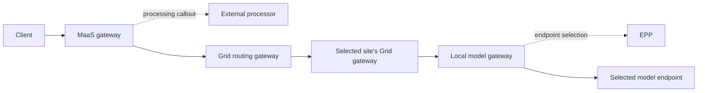

# MaaS and Grid authentication flow

Working design for the new stack, agreed 2026-10-15. MaaS is the public entry
point, using an Envoy-compatible gateway and its external processor. Grid sits
behind MaaS as a trusted routing proxy. This is the target contract; it has not
been validated on the new Dagobah payload.

The external processor is a gateway callout, not another HTTP proxy hop in this
diagram. Identify the selected extproc implementation and gateway filter order
before attributing authentication or authorization to it.

For Grid-managed models, MaaS registers each logical model as an ExternalModel
referencing the same ExternalProvider, `grid`. Grid owns the backing local and
remote serving candidates. Registering that provider alone does not publish its
model catalog into MaaS. The source serving gateways and their EPPs remain behind
Grid for this path.

## The trust boundaries

| Boundary | Identity / decision |
|---|---|
| Client → MaaS | MaaS validates the caller credential and enforces model/subscription access. Verify the exact AuthPolicy, callback and quota wiring in the selected payload. |
| MaaS → Grid | Grid accepts normalized request context only from the trusted MaaS ingress. Bind that trust to an authenticated hop, or a verified signed assertion. Network isolation supports this boundary. |
| Grid → remote Grid | Authenticate the site connection with Grid identity; separately authorize that peer for the selected provider. Membership alone is not model access. |
| Final Grid hop → model gateway | For the #966 integration, use the destination's configured Grid service-account credential, subject to that gateway's authentication and model access checks. |
| Model gateway → EPP/runtime | Apply the local serving configuration, including the selected objective and fairness behavior. Do not infer this wiring merely from a provider being registered. |

MaaS must remove or overwrite client-supplied trusted-context headers. Grid's
trusted listener must not be reachable through a path that bypasses MaaS's checks.
Decide which headers are required and reject missing or invalid required context;
a header's presence is not proof of its origin.

The original user's identity, a Grid site's TLS identity, and a destination's
Kubernetes service account are distinct. Using the Grid service account on the
last hop means the destination authorizes Grid to call the model. It does not
re-authenticate the original user or automatically reproduce that user's MaaS
subscription decision.

## What model-controller #966 provides

The [pinned integration contract](https://github.com/opendatahub-io/odh-model-controller/blob/7c4d60e3cc2d5d9d6776b6bf7cfd5902e5ac1aec/docs/grid-inference-providers.md)
publishes providers from eligible namespaces and configured Gateways, references
administrator-owned service-account token Secrets, and creates model-scoped
access grants. Its managed AuthPolicies preserve forwarded fairness/objective
headers only for the configured Grid identity; authentication and model
authorization remain enabled.

That exception is not a general trust grant for arbitrary user, tenant,
subscription, quota or region headers. Objective names must also have consistent
meaning at participating sites. Removing publication eligibility removes generated
access grants, but cannot revoke unrelated administrator-created permissions.

The current source uses namespace labels and Gateway annotations. The older
lab's `GRID_*` Deployment overrides are not the configuration contract for this
payload.

## Questions to settle by tracing one request

- Which component validates the user credential, and which authorizes the exact
  model that Grid will route? What does the extproc add before those decisions?
- What exact context does MaaS produce: caller, tenant, subscription, authorized
  model, fairness key, objective, region? Which fields does Grid actually consume?
- How does Grid verify the MaaS sender? Choose the concrete connection/assertion
  mechanism and test bypass and header spoofing.
- How is context preserved across the remote hop, and how does the provider
  gateway authorize the calling site before using its local model credential?
- Where is usage charged, including streaming and retries? Avoid assuming that a
  service-account request is charged to the original user's subscription.
- Do disabled keys, denied models, untrusted peers and removed model grants fail
  at the intended boundary?

Enrollment is a separate lifecycle: SiteInvite authorizes joining and issuance
of a site identity. It does not authorize end users to invoke every model.
See [the ACM flow](acm-gitops-flow.md) for delivery and pruning.
