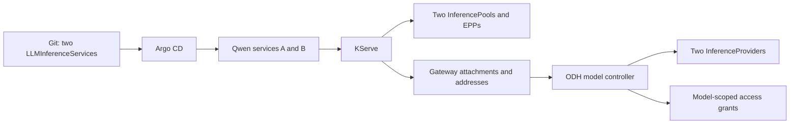

# Documentation handoff: local Qwen publication into Grid

Prepared for Friday, October 16, 2026. This is a lab implementation record for
the ODH-based serving integration, not a supported RHOAI installation procedure.
The evidence files distinguish observed behavior from remaining acceptance work.

## What the user should be able to do

An administrator prepares a Grid-enabled serving Gateway, a Grid identity and
eligible model namespaces. A model owner creates an `LLMInferenceService` through
GitOps. KServe creates its workload, EPP, InferencePool and routes, then reports
the attached Gateway and internal addresses. ODH model controller publishes a
cluster-scoped `InferenceProvider` automatically and grants the Grid identity
access to that model.

There is no manually authored `InferenceProvider` in the deployment chart.
Publication is asynchronous and depends on usable reported routing information.
It is not proof that model weights have loaded or that Grid can serve inference.
In this run, providers appeared while the model download containers were still
running and the services' `Ready` conditions were False.

## Ownership and namespaces

| Resource | Owner | Namespace |
|---|---|---|
| Root Application `dagobah` | Existing bootstrap | `openshift-gitops` |
| Child Application `dagobah-local-models` | Root Application / Git | `openshift-gitops` |
| Model namespaces, Grid identity, Gateway configuration, GridNetwork, LLMInferenceServices | Child Application / Git | See below |
| Model Deployment, EPP Deployment, InferencePool, HTTPRoute, workload TLS material | KServe controllers | Each model namespace |
| InferenceProvider | ODH model controller | Cluster-scoped |
| Model-scoped Role and RoleBinding | ODH model controller | Each model namespace |
| Service-account token bytes | Kubernetes token controller | `qwen-serving` |
| Generated Grid connection configuration and credential mounts | Grid and gateway-owner integration | Still to be connected for these new providers |

The publishing controller is Deployment `odh-model-controller` in `opendatahub`.
KServe's `llmisvc-controller-manager`, `kserve-controller-manager`, and
`kserve-module-controller-manager` and Grid's `grid-operator` are there too.
The platform operator is in `opendatahub-operator-system`.

## Exact local topology

| Service | Physical placement | Advertised model |
|---|---|---|
| `qwen-local-a/qwen3-coder-30b-a3b` | `endor.dagobah.hexfusion.local`, one RTX A5000 | `qwen3-coder-30b-a3b` |
| `qwen-local-b/qwen3-coder-30b-a3b` | `worker2.dagobah.hexfusion.local`, one RTX A5000 | `qwen3-coder-30b-a3b` |

Use separate namespaces to retain independent publisher endpoints and pools for
the same model name. Putting both services into the same model-routing group can
produce a shared KServe publisher endpoint, which changes the meaning of separate
Grid candidates.

Both attach to Gateway `openshift-ingress/qwen-serving`. Its class is
`data-science-gateway-class`, whose controller is
`openshift.io/gateway-controller/v1`. Its backing Service is
`qwen-serving-data-science-gateway-class` in `openshift-ingress`; it uses
ClusterIP HTTPS with an OpenShift service certificate.

This dedicated Gateway does not replace the existing MaaS or data-science Gateway.
The existing MaaS route still lists Grid as its provider. The new services are
not being exposed as alternate direct MaaS providers.



## Prerequisites the procedure must state

1. Install the Grid CRDs before model-controller startup. Its provider watch is
   registered only if the API exists at startup; otherwise restart the controller
   after installing the CRDs.
2. Use the merged implementation from
   [ODH model controller PR #966](https://github.com/opendatahub-io/odh-model-controller/pull/966).
   The deployed model-controller image is pinned in `image-inventory.yaml`.
   Its ClusterRole needs create/delete/get/list/patch/update/watch on
   `grid.praxis.fast/inferenceproviders`.
3. Label each eligible model namespace `grid.opendatahub.io/allowed: "true"`.
   Namespace eligibility is an administrator-controlled access decision.
4. Configure the Gateway annotation below. By default, allowed Gateway namespaces
   are `openshift-ingress`, `opendatahub`, and `redhat-ods-applications`.
5. Grant the Grid operator `get` on the named credential Secret in its namespace.
   The platform role does not grant cross-namespace Secret reads. The Helm chart
   creates a Role restricted by `resourceNames` and binds `opendatahub/grid-operator`.
6. Create the named ServiceAccount and a populated token Secret in the specified
   credential namespace. Git contains the empty Secret declaration and service
   account reference; Kubernetes populates `data.token`. Never commit token bytes.
7. Allow model namespace routes to attach to the Gateway. This chart uses the
   namespace label `grid-local-serving: "true"` in `allowedRoutes`.
8. Create the LLMInferenceServices with direct Gateway refs and model auth enabled.
   Wait for KServe to report the matching Gateway attachment and internal address.

The working annotation is:

```yaml
grid.opendatahub.io/serving: >-
  {"networkName":"dagobah-local","namespace":"qwen-serving",
   "serviceAccount":"grid-model-client","tokenSecret":"grid-model-client-token",
   "siteLabels":"grid.praxis.fast/provider-site=dagobah"}
```

The controller creates a namespaced Role granting `get` on the specific
`serving.kserve.io/llminferenceservices` resource name, and binds it to
`qwen-serving/grid-model-client`. Do not replace this with broad model access.
The credential account should not have independent model grants that would
survive controller-managed grant removal.

## Publication evidence and endpoint semantics

The initial live audit passed for both objects:

| Source namespace | Generated provider | Created (UTC) |
|---|---|---|
| `qwen-local-a` | `grid-qwen-local-a-qwen3-coder-32043b452d216289e8a78eecad00e5485` | 2026-10-16 01:09:13 |
| `qwen-local-b` | `grid-qwen-local-b-qwen3-coder-3b38c30722f75942dc2e2fa5dc63129ab` | 2026-10-16 01:10:02 |

Both services were created at 01:07:34 UTC. Those intervals are observations,
not a publication latency guarantee. Generated names incorporate source identity;
do not teach users to construct or hard-code them.

Each provider's endpoint is the KServe-reported URL:

```text
https://qwen-serving-data-science-gateway-class.openshift-ingress.svc.cluster.local/publishers/qwen-local-a/models/qwen3-coder-30b-a3b
https://qwen-serving-data-science-gateway-class.openshift-ingress.svc.cluster.local/publishers/qwen-local-b/models/qwen3-coder-30b-a3b
```

The base path is part of the endpoint contract. Grid must preserve it when adding
the inference API path. The provider advertises the unqualified model name,
`providerKind: vllm`, `backendKind: local_model`, `gridNetworkRef: dagobah-local`,
and `auth.strategy: bearer_token` with the Secret reference. `routingClusterRef`
is omitted: Grid uses the provider name as its routing identity unless explicitly
overridden. The audit checks source service UID, Gateway UID, reported endpoint,
model name, credential reference and generated Role/RoleBinding.

The actual InferencePool used by this deployed Gateway is the
`inference.networking.x-k8s.io` API, selected by KServe's capability detection.
Do not assume the newer `inference.networking.k8s.io` group is the active pool API
just because its CRD is installed.

## GitOps workflow and validation

The reusable chart is `workloads/local-models/`; lab input is `values/lab.yaml`.
The root renders `apps/templates/local-models.yaml`. Both Applications use manual
sync during qualification and have no automatic prune or cascading deletion.
Changes were signed, pushed to `main`, then synced through Argo. Workloads were
not manually applied or patched outside their declared resources.

Helm lint and server-side dry runs passed before the initial sync. Argo uses
server-side apply. The child ignores only the generated token Secret's `/data`;
it does not ignore arbitrary model or Gateway spec drift.

Useful inspection commands, after selecting the Dagobah context:

```sh
oc get applications.argoproj.io -n openshift-gitops
oc get llminferenceservices.serving.kserve.io -n qwen-local-a -o yaml
oc get llminferenceservices.serving.kserve.io -n qwen-local-b -o yaml
oc get inferenceproviders.grid.praxis.fast -o yaml
oc get inferencepools.inference.networking.x-k8s.io -A
oc get pods -n qwen-local-a
oc get pods -n qwen-local-b
oc logs deployment/odh-model-controller -n opendatahub --tail=50
```

Argo's `Healthy` result in this installation does not establish model readiness:
it reported Healthy while LLMInferenceService `Ready` was False. Inspect workload
conditions, pod state and actual inference separately. With one replica and
`maxUnavailable: 1`, Deployment Available and LLMInferenceService Ready also
became True while the model pod was still initializing. Require a ready model
container and successful inference before declaring the model available.

## Runtime and troubleshooting findings

The two nodes have one RTX A5000 each. The AWQ model variant matches the earlier
remote canary; its repository moved from `cpatonn` to `cyankiwi`. The exact
Hugging Face revision and all image digests are in lab values. The model URI uses
the storage initializer's `hf://owner/model:revision` syntax.

ODH KServe's GPU template selects **Red Hat AI Inference Server 3.2.4**, not an
ODH-built vLLM image. EPP and storage initializer are ODH builds. Document this
exception explicitly; do not describe every image as ODH-built. Registry access
and source/OCI-label inspection do not constitute signature verification.

| Finding | Recorded action or implication |
|---|---|
| Downloader exceeded its initial 4 GiB limit, exit 137 / OOMKilled | Set initializer limit 8 GiB, request 1 GiB; disable optional HF Xet downloader. Validate completion before calling this resolved. |
| One GPU per node, default surge keeps replacement Pending | Declare `rolloutStrategy.maxSurge: 0`, `maxUnavailable: 1` on the LLMInferenceService. An instance has downtime during replacement. |
| API normalization caused Argo drift | Set the Gateway certificate reference group explicitly to `""`; omit an empty capability-add list. |
| Runtime weights are currently pod-local | Pod replacement downloads again. Persistent model caching is a follow-up. |
| Gateway API schema drops generated HTTPRoute rule names | Controller logs warnings about `spec.rules[].name`; routes nevertheless report Ready. Record compatibility evidence; do not upgrade the platform Gateway API implicitly. |
| EPP image ID differs from its configured manifest-list digest | Verified: pinned index `872de481` contains amd64 child `7f8a0ec7`, which matches both live EPP pods. See the image-index evidence. |

The initial runtime settings are 8192 context tokens, eight concurrent sequences,
FP16 compute and eager execution. These are lab starting values, not a published
performance recommendation or a validated capacity guarantee.

## Claims to keep separate

Automatic provider creation and model-scoped grant creation are **verified**.
The companion local rollout record and evidence contain current runtime status.
Do not infer runtime readiness from provider presence or from Argo health.

The new GridNetwork initially has no `gatewayRefs`. These providers are not yet
connected to the existing manually configured Grid canary. The current renderer drops the publisher base path ([Grid #248](https://github.com/praxis-proxy/grid/issues/248)); carrying it into final-hop routing is required for these URLs. Full Grid-generated
routing, credential projection, backend CA trust, protected local inference and
local-versus-remote selection still require separate acceptance evidence.

The earlier remote canary did pass JSON and incremental SSE through MaaS/Praxis
and two Grid hops without changing the existing Envoy image or its eight filter
specifications. Its final backend hop was direct vLLM, not the protected KServe/EPP
path. See [the serving rollout](serving-rollout-20261015.md).
Do not turn that result into a blanket statement about bearer-token forwarding,
verification or stripping at every Grid hop.

The exact unchanged MaaS Envoy version in that test was
`06f9604a19dcdece315aea66ce7941746c826a6d/1.34.2-dev/3.1.0/RELEASE/OpenSSL`,
from the pinned Service Mesh image. The fix carried explicit effective processing
modes in Praxis and the AI Gateway configuration producer; it did not require an
Envoy upgrade. Full payload qualification remains open.

## Material for Friday's call

Start with the ownership table and the live two-service/two-provider example.
Agree on the administrator prerequisites versus the model owner's create flow.
Then walk through endpoint/base-path behavior, provider creation versus readiness,
credential references versus credential handling, and the remaining acceptance
gates. The docs should present the validated installation path and label
experimental/manual carry requirements rather than imply a supported release.

The concrete chart, image inventory, source pins, runtime findings and raw
credential-free publication audit accompany
[the local Qwen rollout](local-qwen-serving-20261015.md).


## A5000 runtime driver selection

The pinned RHAIIS 3.2.4 image includes a CUDA 12.8 compatibility driver
(`570.195.03`). Both A5000 nodes run driver `580.126.20`; the image's default
library resolution selected the bundled older driver and failed CUDA initialization
with error 803. An isolated process in the model container reproduced that result,
then returned success with the node-provided `/usr/lib64/libcuda.so.580.126.20`.

The lab values now set `localServing.runtimeEnv.LD_LIBRARY_PATH` to
`/usr/lib64:/usr/local/cuda/lib64` and `NUMBA_CUDA_DRIVER` to
`/usr/lib64/libcuda.so.1`. The chart renders these into the LLMInferenceService;
KServe remains the owner of the generated Deployment. The image digest and node
driver remain unchanged. This is a correction for this specific image/driver pair,
not a general recommendation to override CUDA paths for every runtime.

Evidence: `tests/local-serving/cuda-driver-probe.json`. CUDA initialization success
is a prerequisite; model readiness, protected inference and Grid routing remain
separate acceptance checks.
