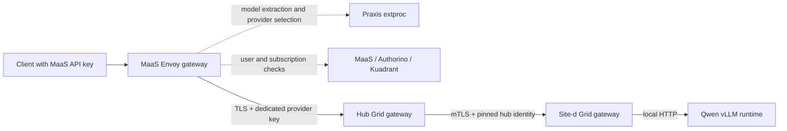

# MaaS to Grid manual inference — 2026-10-15

This is the earlier workaround record. The [current rollout](serving-rollout-20261015.md)
passes live JSON/SSE with the original Envoy image and filter configuration unchanged.

Nonstreaming and streaming OpenAI Chat Completions passed through MaaS, the hub
Grid gateway, the site-d Grid gateway, and a real Qwen model. This is a manual
canary with a temporary Envoy compatibility workaround, not full payload acceptance.
The deployments are not managed by the new Argo root yet.

## Registration and ownership

For the selected MaaS/Praxis implementation, use an `ExternalProvider` for the
Grid ingress and an `ExternalModel` for each public logical model. A
`MaaSModelRef` references that ExternalModel; `MaaSAuthPolicy` and
`MaaSSubscription` determine who may invoke it and under which subscription.
The supported MaaSModelRef backends are ExternalModel and LLMInferenceService.
An HTTPRoute or Service alone does not supply MaaS model registration or access
control. Use LLMInferenceService when KServe actually owns the serving topology.

MaaS does not discover Grid's model catalog and create these registrations today.
An administrator, provisioning API, or GitOps supplies them. The AI Gateway
controller reconciles the derived route, provider connection, routing overlay,
and credential mounts; MaaS reconciles authorization and subscription resources.
Grid selects the downstream site. A shared Grid ingress does not require one
ExternalProvider per site.

The public model name, ExternalModel name, MaaSModelRef name, and backend served
name are identical in this canary. Arbitrary target-model translation, endpoint
base paths, and the Responses API are not qualified by these results.

## Tested path



The Grid gateways use Helm chart 0.2.0 from the pinned PR #181 chart source.
The hub listener uses an OpenShift service certificate and a file-backed Praxis
API-key policy. MaaS injects a dedicated provider key; Grid validates and removes
it before forwarding. The hub's NetworkPolicy admits the MaaS gateway pods.
Site-d accepts the pinned hub certificate and forwards to the local model Service.
The static route and manually issued seven-day identities do not exercise
GridNetwork/GridSite reconciliation, enrollment, SiteInvite, or renewal.

The model is `cpatonn/Qwen3-Coder-30B-A3B-Instruct-AWQ-4bit`, served as
`qwen3-coder-30b-a3b` on the two-GPU k3s spoke. Selected image digests and observed
workloads are in [the inventory](image-inventory.md). Non-secret lab inputs are
under `manualCanary` in [historical canary inputs](../evidence/2026-10-15/manual-canary-inputs.yaml). Credentials and private
keys are intentionally absent; those values alone cannot recreate identities.

## Results and limits

| Check | Result |
|---|---|
| Direct hub Grid → site-d → Qwen | HTTP 200, expected text |
| MaaS → Grid → site-d → Qwen, nonstreaming | Two HTTP 200 responses, expected text, 21 reported tokens each |
| Same path, streaming | HTTP 200, completion chunks, usage event, `[DONE]` |
| MaaS missing credential | HTTP 401 |
| MaaS invalid credential | HTTP 401 |
| Valid key, unregistered model | HTTP 404 |
| Registration | ExternalProvider, ExternalModel and MaaSModelRef Ready |

Client probes used localhost port-forward to the actual MaaS gateway Service,
with certificate verification against the service CA. The requests then traversed
the actual in-cluster gateway-to-Grid connection and remote Grid hop. Public
OpenShift Route access was not part of this acceptance check. Catalog readiness
alone did not imply inference health: the model was Ready during the earlier 500s.

Reported token usage is not proof of quota accounting. Counter updates,
exhaustion/429, streaming billing, retries, revoked-key rejection, and an existing
but unauthorized model remain to test. Kuadrant's observed rate-limit service
failure mode is `allow`; auth is `deny`. The selected internal extproc manifests
accept self-signed certificates without chain verification. These are explicit
qualification gaps, not an assertion that all hops are fully verified.

## Corrections needed to reach the working canary

1. Use the published AI Gateway controller image at source
   `5502164817b40c8e1760ed50758cfc232fc1f2d4` (digest in inventory). The older
   candidate addressed the ExternalModel processor in the gateway namespace
   instead of its tenant namespace. The newer image includes the tenant lookup
   correction from [AGC #105](https://github.com/opendatahub-io/ai-gateway-controller/pull/105).
   Praxis selection belongs on MaaSTenantConfig's
   `maas.opendatahub.io/payload-processing-type` annotation; the temporary AITenant
   annotation was removed.
2. Set RHCL Subscription `spec.config.env` entry `AUTH_SERVICE_TIMEOUT=2s`.
   The original 200ms timeout produced gateway 500s even when Authorino eventually
   authorized the request. This is the documented
   [MaaS deployment setting](https://opendatahub-io.github.io/models-as-a-service/v2.0.1/install/platform-setup/).
3. Raise the Kuadrant operator's memory request to 512Mi and limit to 1Gi through
   its Subscription, preserving its CPU settings. Its original 300Mi limit caused
   OOM kills and prevented reconciliation of the timeout setting.
4. Mount an injected service CA in the MaaS gateway and reference its path in
   ExternalProvider `config.tls.caCertificates`. Setting that field does not
   create a CA mount. The current Deployment patch needs a durable owner.
5. Apply the model-scoped **temporary** body-mode workaround described below.

MaaS/Praxis image overrides are applied to the platform Deployment in addition
to the rebuilt #4186 base image. They are recorded separately from the base
payload, which remains unchanged. The API-key cleanup CronJob still uses the
mutable UBI 9.7 tag supplied by the managed manifests; it must be digest-pinned
before this can be a complete image lock.

## Envoy/Praxis compatibility: demonstrated root cause and workaround

The gateway reports `1.34.2-dev/3.1.0`. The generated ExternalModel filter has
global request-body mode `NONE` and route override `STREAMED`. Envoy 1.34.2's
`encodeProtocolConfig` sends the global mode, so Praxis receives `NONE` followed
by RequestBody and rejects the inconsistent exchange:

```text
received RequestBody message while its body mode is NONE
```

[Envoy #39650](https://github.com/envoyproxy/envoy/pull/39650), commit
`ff60e2e3e6dea33d4b1048906545afd7de1a418a`, fixes the report to use the effective
decoder/encoder modes. Source comparison confirms that correction in upstream
v1.35.0. A downstream build must be checked for its actual backport; its version
string alone is not sufficient.

The canary-only EnvoyFilter `grid-canary-extproc-body-mode` sets `NONE` for the
four routes belonging to the Qwen ExternalModel. Its post-auth processing needs
headers for provider selection and credential injection; pre-auth processing
still extracts the model from the buffered body. Nonstreaming and streaming pass
with that override. This is **not an established upstream controller fix** and
does not justify relaxing Praxis validation or ignoring incompatible modes.

The current rollout keeps the deployed Envoy image and configuration. The custom
Praxis and controller images are deployed, and the live remote Grid JSON/SSE test
passes for normal and chunked uploads. KServe and the merged #966 controller are
Ready; the protected LLMInferenceService/EPP path remains unqualified. The earlier
Envoy override is historical evidence. See the [current rollout record](serving-rollout-20261015.md).

## Isolated MaaS reproducer

[The reproducible test](../tests/maas-extproc/README.md) substitutes a digest-pinned
TLS Katan mock for Grid and vLLM, while retaining real MaaS auth and Praxis.
It creates run-owned model/provider/subscription resources and a short-lived key.
On this lab it reproduced HTTP **500 → 200 → 500** for original route mode,
matching-mode control, and restored original mode. It revoked the API key and
removed its resources. This establishes that Grid routing is not required to
trigger the failure. Run its `--expect fixed` mode when qualifying an updated
gateway/Praxis combination.

## Next auth boundary

The canary's last hop is local plaintext HTTP to vLLM. It does not yet prove
forwarding into another protected MaaS or serving gateway. That destination must
authenticate its own Grid service credential and authorize the model; it should
not receive the original user's MaaS API key. Decide explicitly whether destination
quotas apply to the Grid service identity or whether a separate delegated-user
contract is needed. See [the auth flow](auth-flow.md) for the decisions and tests.
